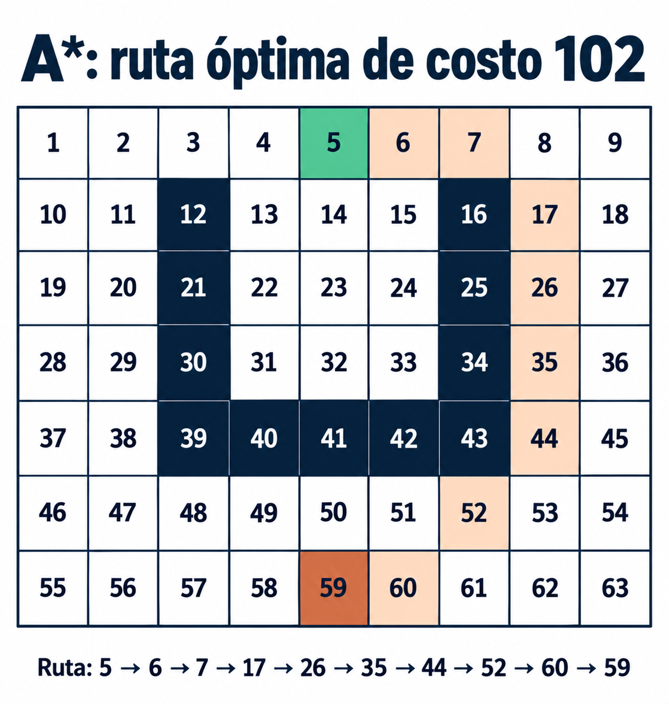
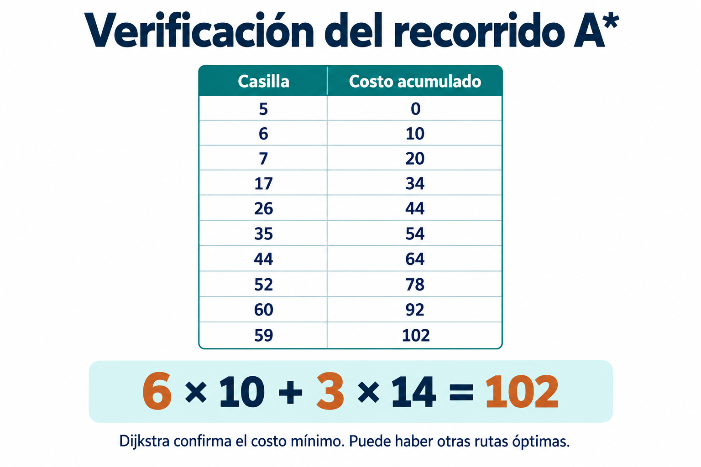

# Búsqueda A* sobre 63 casillas

Tablero de 7 filas y 9 columnas, numerado de izquierda a derecha y de arriba abajo. Inicio 5, meta 59. Muros: 12,16,21,25,30,34,39,40,41,42,43.

Se admite movimiento a ocho vecinos, con costo 10 ortogonal y 14 diagonal, **incluyendo pasar por una esquina junto a un muro**. Esta regla es necesaria para conservar la ruta de referencia, que pasa de 44 a 52 junto a 43. Prohibir ese paso define otra búsqueda y puede cambiar el óptimo.

La ruta **5→6→7→17→26→35→44→52→60→59** cuesta **102**. Escrita desde la meta es la misma secuencia del apunte: 59,60,52,44,35,26,17,7,6,5.

Se usa distancia octil como heurística admisible. Se contrasta el costo con Dijkstra (heurística cero). Puede haber varios caminos óptimos y distintas listas abiertas/cerradas por desempates; no se exige reproducir las listas manuscritas inconsistentes. El programa imprime su propia expansión reproducible.
