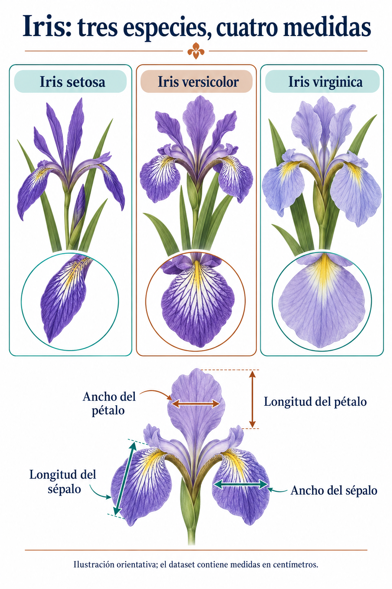

# Identificación de Iris

El CSV de referencia contiene 150 registros y cuatro medidas sin encabezado ni etiqueta. Se conserva exactamente para reproducir el análisis: longitud y ancho del sépalo, longitud y ancho del pétalo, en centímetros.

Los bloques convencionales de 50 corresponden a setosa, versicolor y virginica. Para entrenar hay que verificar e incorporar esas etiquetas; el número de fila no debe ser predictor. Los pétalos pequeños separan el primer grupo, pero los otros dos se solapan. Las filas no están ordenadas por tamaño y no se cumple que cada columna sea siempre mayor que la siguiente.

Esta lámina generada es orientativa, no una clave botánica validada. La comprobación usa medidas. `verificacion/resultados.json` registra rangos y medias calculados por bloque.
