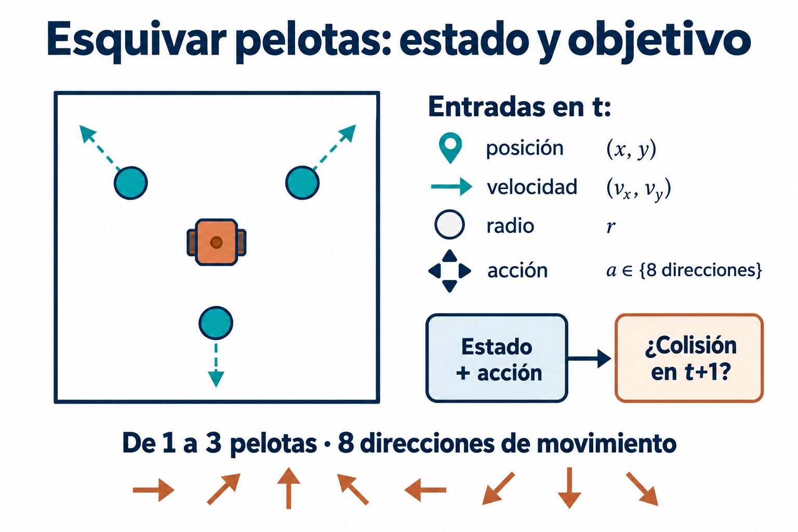
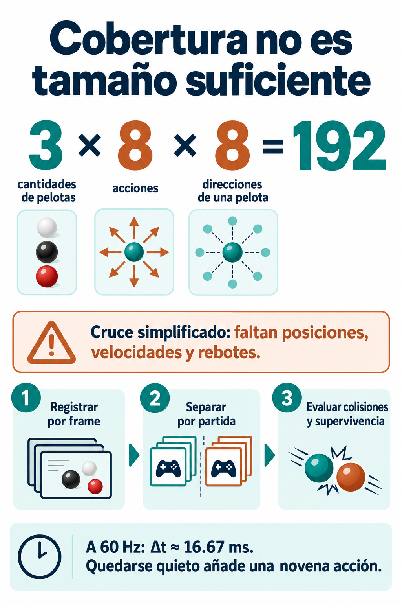

# Datos para esquivar pelotas

El personaje parte del centro y tiene ocho direcciones de movimiento. Hay entre una y tres pelotas, con estados iniciales aleatorios y cambios de velocidad al rebotar.

Una fila representa el estado en t y una acción candidata. Objetivo booleano: colisión en t+1. Guardar partida, tiempo, posición y velocidad del jugador, acción, cantidad de pelotas y, para cada una, posición, radio y velocidades x/y. Una máscara distingue pelotas ausentes. La distancia se deriva de posiciones; rapidez sin dirección no basta.

Usar unidades explícitas: píxeles y segundos, por ejemplo muestrear cada 1/60 s. Separar partidas completas al evaluar.

## Corrección
3×7×8=168 contradice las ocho direcciones del enunciado. Un cruce simplificado de tres cantidades de pelotas, ocho acciones y ocho direcciones de UNA pelota representativa da **192 combinaciones**. No es el mínimo suficiente para aprender: omite posiciones, velocidades, radios, rebotes y direcciones independientes de las demás pelotas. Si se admite quedarse quieto, hay nueve acciones.

Repetir escenarios y medir recobrado de choques, falsas alarmas y supervivencia. Datos sesgados pueden hacer que el agente vaya hacia la pelota o quede atrapado en una esquina.
