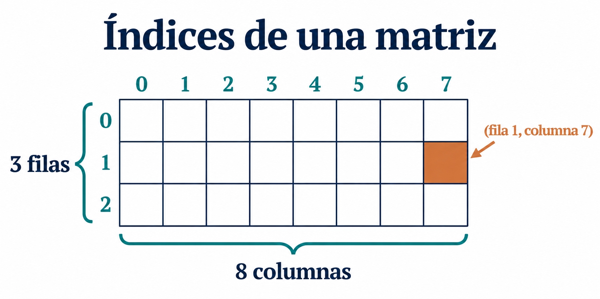

# Cinco problemas de búsqueda

## Cuatro reinas
En un tablero 4×4, colocar las reinas en **(1,3), (2,1), (3,4), (4,2)**, contando desde 1. Columnas, diferencias fila−columna y sumas fila+columna son todas distintas: no hay ataques.

## Josephus
Eliminando a cada segunda persona y empezando en la 1, sobrevive `2*(n−2^floor(log2(n)))+1`. Para n=7, sobrevive la 7. Si cambia el comienzo, se rota el resultado módulo n. Esto supone eliminar al vecino consecutivo; eliminar al diametralmente opuesto es otro problema.

## Misioneros y caníbales
El bote admite una o dos personas. En cada orilla con misioneros, estos no pueden quedar en minoría. Una orilla sin misioneros es válida.

| Paso | Pasajeros | Sentido | M,C a la izquierda |
|---|---|---|---|
| 0 | — | — | 3,3 |
| 1 | CC | → | 3,1 |
| 2 | C | ← | 3,2 |
| 3 | CC | → | 3,0 |
| 4 | C | ← | 3,1 |
| 5 | MM | → | 1,1 |
| 6 | MC | ← | 2,2 |
| 7 | MM | → | 0,2 |
| 8 | C | ← | 0,3 |
| 9 | CC | → | 0,1 |
| 10 | C | ← | 0,2 |
| 11 | CC | → | 0,0 |

## Laberinto
Una búsqueda en anchura visita vecinos por sus cuatro lados, guarda el predecesor y evita revisitar casillas. En la matriz original de 3×8, desde (0,0) hasta (1,7), el camino mínimo requiere **12 movimientos**, contando coordenadas desde cero. No se modifica la matriz.

## Islas
Explorar cada componente de unos unidos por lados y contarla una sola vez. Las diagonales no conectan islas. El ejemplo original tiene **5 islas**. Tiempo O(filas×columnas). El código y las aserciones están en `soluciones.py` y `../verificacion/comprobar.py`.
