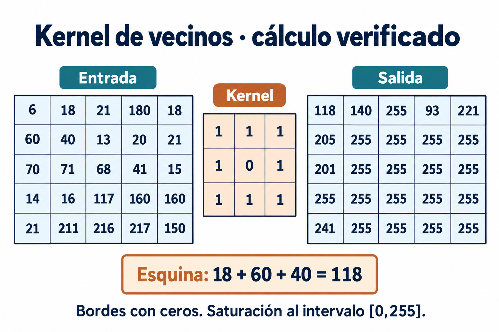

# Kernel de vecinos

La entrada se transcribió de la imagen del ejercicio. Kernel 3×3 de unos con centro cero, paso 1, extensión con ceros y salida saturada a [0,255]. Al ser simétrico, convolución y correlación coinciden.



```text
Entrada
 6  18  21 180  18
60  40  13  20  21
70  71  68  41  15
14  16 117 160 160
21 211 216 217 150

Salida
118 140 255  93 221
205 255 255 255 255
201 255 255 255 255
255 255 255 255 255
241 255 255 255 255
```

La esquina superior izquierda suma 18+60+40=118. En (fila 1,columna 4), contando desde 1, los vecinos válidos suman 21+18+13+20+21=93. Se excluye el centro.

El apunte mostraba 96 y otros valores incompatibles con la matriz. Esta versión corrige el resultado; no pretende conservar errores para aparentar equivalencia. La nota original sobre valores mayores de 255 es ambigua; aquí se explicita la saturación usada por su tabla. Para sumas sin saturación, ejecutar `convolucion(ENTRADA, saturar=False)`.
